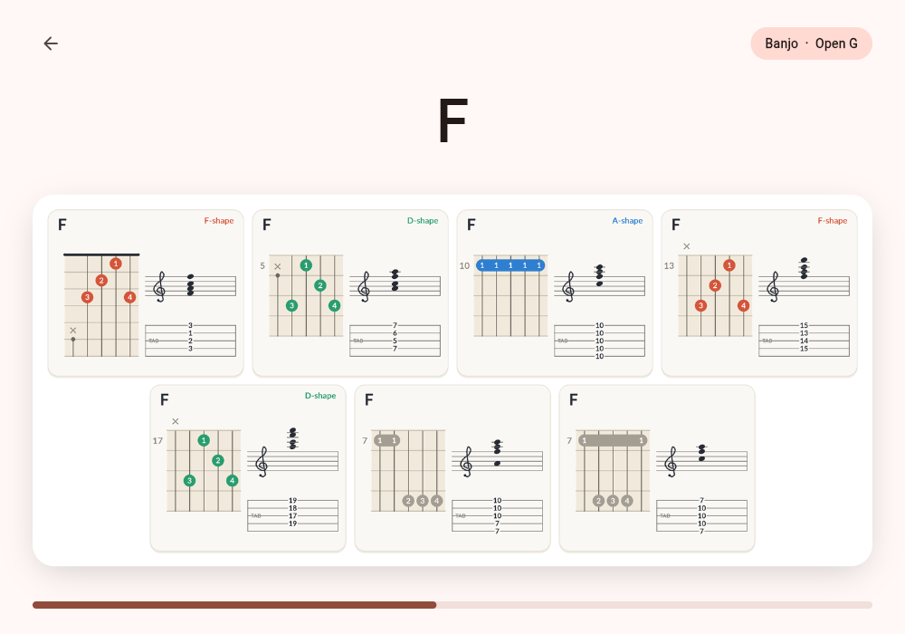
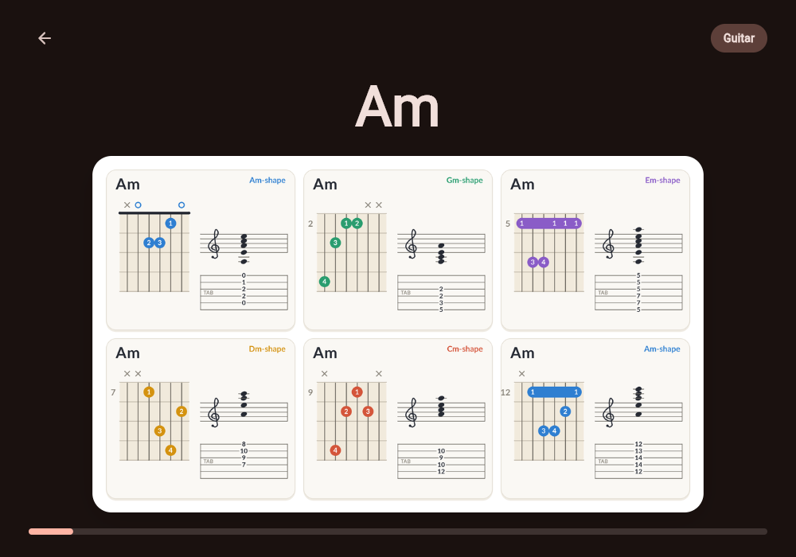
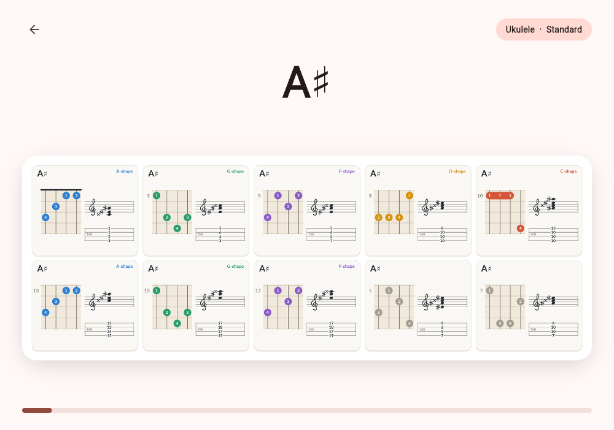
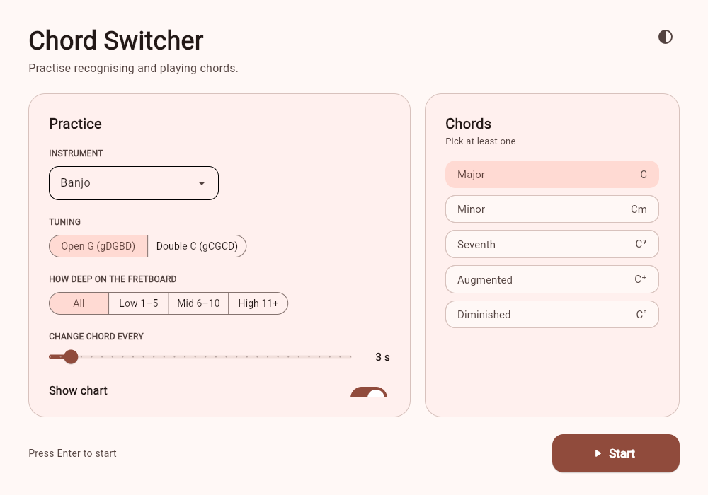

# Chord Switcher

A desktop app for practising chords. Pick an instrument and the kinds of chord you want to work on, and it shows a random chord every few seconds, with every way to play it drawn on the instrument.


[](https://github.com/j-vb/chord_switcher/actions/workflows/tests.yml)
[](https://github.com/j-vb/chord_switcher/actions/workflows/build-windows.yml)
[](https://github.com/j-vb/chord_switcher/actions/workflows/build-macos.yml)
[](https://github.com/j-vb/chord_switcher/actions/workflows/build-ubuntu.yml)
[](LICENSE)

| Banjo, open G | Guitar, dark mode |
|---|---|
|  |  |
| **Ukulele** | **Menu** |
|  |  |

## Download

Get the app for your system from the [latest release](https://github.com/j-vb/chord_switcher/releases/latest). It needs no Python or other installs.

| System | File |
|---|---|
| Windows | `chord_switcher-windows.zip` |
| macOS, Apple Silicon (M1 and later) | `chord_switcher-macos-apple-silicon.zip` |
| macOS, Intel | `chord_switcher-macos-intel.zip` |
| Linux | `chord_switcher-linux.tar.gz` |

Unzip it and start `ChordSwitcher`. The app isn't signed, so your system warns you the first time you open it:

- **Windows**: SmartScreen says "Windows protected your PC". Click **More info**, then **Run anyway**.
- **macOS**: the Mac says it can't check the app for malicious software. Close the message, go to **System Settings → Privacy & Security**, and click **Open Anyway** next to ChordSwitcher.
- **Linux**: if it doesn't start, make it executable first with `chmod +x ChordSwitcher`. The app needs GTK 3, EGL and libsecret, which desktops such as Ubuntu, Fedora and Mint already have. On a minimal system, an error like `libgtk-3.so.0: cannot open shared object file` means they're missing: install `libgtk-3-0`, `libegl1` and `libsecret-1-0` (Debian and Ubuntu names).

## Features

- **Six instruments**: piano, guitar, 5-string banjo, tenor banjo, ukulele and baritone ukulele.
- **Tunings**: instruments with more than one common tuning get a tuning switch, such as open G or double C on the banjo.
- **Every way to play a chord**, from the nut up to the 19th fret, with fingers, a staff and tab on each card.
- **Chord figures first**: the shapes players slide along the neck, such as the banjo's F, A and D shapes or the guitar's CAGED shapes, come first, each in its own colour.
- **Depth on the neck**: practise low, middle or high on the fretboard, or any two of them together.
- **Piano inversions**: practise root position and any of the 1st, 2nd and 3rd inversions.
- **Chord kinds**: major, minor, seventh, augmented and diminished, in all twelve keys.
- **A clean, modern window** built with [Flet](https://flet.dev): light and dark mode, charts that rearrange to fit the window as you resize it, and keyboard shortcuts.

## Instruments

| Instrument | Tunings | Chord figures |
|---|---|---|
| Piano | | Inversions instead of figures |
| Guitar | Standard (EADGBE) | The five CAGED shapes |
| Banjo, 5-string | Open G (gDGBD), Double C (gCGCD) | Open G: F, A and D shapes. Double C: barre, triangle and F-shape |
| Tenor banjo | Standard (CGDA), Irish (GDAE) | Three movable shapes per kind of chord |
| Ukulele | Standard (gCEA), Low G (GCEA) | C, A, G, F and D shapes |
| Baritone ukulele | Standard (DGBE) | G, E, D, C and A shapes |

## Running from source

You need [Python](https://www.python.org/downloads/) 3.14.

```sh
git clone https://github.com/j-vb/chord_switcher.git
cd chord_switcher
python -m venv .venv
```

Activate the environment:

```sh
source .venv/Scripts/activate      # Windows, Git Bash
.venv\Scripts\Activate.ps1         # Windows, PowerShell
source .venv/bin/activate          # macOS and Linux
```

Then install and start the app:

```sh
pip install -r requirements.txt
python src/chord_loop.py
```

## Using the app

The menu has two cards. **Practice** sets up the session and **Chords** picks the kinds of chord.

| Setting | What it does |
|---|---|
| Instrument | The instrument to practise on |
| Tuning | Shown for instruments with more than one common tuning |
| How deep on the fretboard | All, or one or two of Low (frets 1–5), Mid (6–10) and High (11+). Picking all three switches back to All |
| Inversions | For the piano: any of root position and the 1st, 2nd and 3rd inversion. Each chord gets a random one of them |
| Change chord every | 1 to 30 seconds |
| Show chart | Draws each chord on the instrument. Without it, only the chord name is shown, large |
| Chords | Major, minor, seventh, augmented and diminished. Pick at least one |

Press **Enter** to start and **Escape** to go back to the menu, which keeps your settings. The button at the top right of the menu switches between light and dark mode.

### Reading a chart

Each card is one way to play the chord:

- **Fretboard**: the dots are fingers (1 is the index finger). A long dot is a barre: one finger across several strings. ○ is an open string and × a string you leave out. A number next to the board is the fret it starts at.
- **Figure**: the name at the top right, such as *F-shape*, and the colour of the dots show which chord figure the card is. A figure keeps its colour for its minor and seventh versions. Shapes that are not a figure are grey.
- **Staff and tab**: the notes the shape plays, and the frets as tablature with the highest string on top.
- **The banjo's 5th string** starts at the 5th fret, so it is drawn from a peg there. It is played open when its g belongs to the chord. Otherwise it is fretted up the neck when a finger is free, and marked × when it can't be played.

## Chord figures

Players learn a few chord figures per instrument and slide them up and down the neck. The app shows each figure at every fret where it makes the chord, before any other shape.

| Instrument | Major | Minor | Seventh |
|---|---|---|---|
| Banjo, open G | F, A and D shapes | Fm, Am and Dm shapes | F7, A7 and C7 shapes |
| Banjo, double C | Barre, triangle and F-shape | | |
| Guitar | C, A, G, E and D shapes (CAGED) | Cm, Am, Gm, Em and Dm shapes | C7, A7, G7, E7 and D7 shapes |
| Ukulele | C, A, G, F and D shapes | Cm, Am, Gm, Fm and Dm shapes | C7, A7, G7, F7 and D7 shapes |
| Baritone ukulele | G, E, D, C and A shapes | Gm, Em, Dm, Cm and Am shapes | G7, E7, D7, C7 and A7 shapes |
| Tenor banjo, standard | E♭, C and G shapes | Dm, Cm and Gm shapes | D7, C7 and G7 shapes |
| Tenor banjo, Irish | B♭, G and D shapes | Am, Gm and Dm shapes | A7, G7 and D7 shapes |

Most figures are named after the chord they make at the nut or low on the neck. The baritone ukulele shares the ukulele's shapes, and the Irish tenor banjo the standard one's, each a fifth apart, so the names shift accordingly. On the guitar, the C7-shape leaves out the high E string and the Gm-shape the two highest strings when moved up the neck, as chord guides teach them, since the full forms need five fingers.

Augmented chords have one figure on every instrument, the **Aug-shape**: the augmented chord at the nut. An augmented chord is symmetrical, so its shape makes the next augmented chord four frets higher and appears every four frets. Diminished chords, which the app plays as three-note triads, have no standard figures, and neither have minor and seventh chords on the double-C banjo, so their shapes are drawn in one colour.

## Building a standalone app

`build.py` packs the app into one executable with `flet pack`, which uses PyInstaller:

```sh
pip install "flet[cli]" pyinstaller
python build.py
```

The app lands in `dist/`: `ChordSwitcher.exe` on Windows, `ChordSwitcher.app` on macOS and `ChordSwitcher` on Linux.

GitHub builds it too, with one workflow each for Windows, macOS (Apple Silicon and Intel) and Linux, for every pull request and push to `main` that changes the app. Pushing a tag such as `v1.0.0` attaches the four builds to a release:

```sh
git tag v1.0.0
git push origin v1.0.0
```

## How it works

```
build.py                Builds the executable
src/
  chord_loop.py         The app: menu, practice view and timer, built with Flet
  piano_drawer.py       Piano charts: a three-octave keyboard with inversions
  guitar_drawer.py      Guitar charts: open chords and the CAGED shapes
  fretted_drawer.py     Banjo, tenor banjo and ukulele charts in any tuning, and the chord figures
  chart_common.py       What every chart shares: chord spelling, the card, the staff, fonts and colours
  banjo_voicings.py     Hand-picked voicings for the open-G banjo
  assets/fonts/         DejaVu Sans and DejaVu Sans Bold, for systems without the usual fonts and for the ♯, ♭ and other chord symbols
tests/                  Checks every chord shape on every instrument
```

The charts are [Pillow](https://python-pillow.org/) images, drawn at four times their size and scaled down for smooth edges. The app draws the next chord in the background while the current one is showing, crops the chart to what is drawn, and picks the number of columns that makes the cards largest in the window.

`fretted_drawer.py` works out the voicings from the tuning itself. It tries every shape on the neck whose notes all belong to the chord and that holds the root and the third, and the seventh of a seventh chord. Four strings may drop the fifth of a seventh chord. Shapes must fit in a reach of three frets, or four on instruments tuned in fifths, like the tenor banjo. It then gives each shape fingers like a player would, with a barre where the notes at the lowest fret need one. Open strings only count near the nut: higher up, a shape with an open string is just a closed shape with one note swapped.

### Adding a tuning or an instrument

Tunings are listed in `INSTRUMENTS` in `fretted_drawer.py`, with the written pitch of each open string as a MIDI number, from the string on the left of the chart to the one on the right:

```python
"Mandolin": (
    Tuning("Standard", (55, 62, 69, 76)),  # G D A E, written at pitch
),
```

The voicings, fingers, staff and tab follow from that. To show chord figures for it, add a `figures` table like `UKULELE_FIGURES`, with the frets each figure has at the nut.

## Tests

The tests check every chord in every tuning: that each shape plays only notes of its chord and holds the root and third, that its fingers can be held, that each chord figure appears wherever it makes the chord, that standard open chords from chord charts are there, and that related tunings give the same shapes. They run on GitHub for every pull request and every push to `main`. They only cover the chart drawers, not the app window, and give the same results on every system, so they run on Linux only.

```sh
pip install -r requirements-dev.txt
pytest
```

## Roadmap

- Minor and seventh figures for the double-C banjo
- More instruments, such as mandolin and bass, and more guitar tunings, such as drop D and DADGAD
- MIDI input to check the chord you play

## Sources and further reading

- Tenor banjo: the movable shapes and their fingers come from [banjochords.net](https://banjochords.net/chords/tenor/), and the Irish open chords were checked against [Tradtab](https://tradtab.com/tenor-banjo/chords/).
- Banjo, double C: the barre, triangle and F-shape are named in [Peghead Nation's clawhammer course](https://www.pegheadnation.com/string-school/courses/clawhammer-banjo/movable-chords-double-c-tuning/). The barre matches [this Banjo Hangout thread](https://www.banjohangout.org/archive/313626) and the triangle [Songtive's double-C chords](https://www.songtive.com/en/chords/five-string-banjo/double-c/C).
- Guitar: the CAGED system, explained in [D'Addario's guide](https://www.daddario.com/the-lesson-room/guitar/guitarists-guide-to-the-caged-system/). The partial C7 and Gm shapes are covered in [Online Guitar Books](https://onlineguitarbooks.com/?p=22021) and [MusicRadar](https://www.musicradar.com/how-to/play-guitar-chords-across-the-entire-fretboard-heres-how).
- Banjo, open G: [Deering's 5-string banjo guide for guitar players](https://www.deeringbanjos.com/pages/5-string-banjo-for-guitar-players).

## License

Chord Switcher is released under the [MIT license](LICENSE). The [DejaVu](https://dejavu-fonts.github.io/) fonts in `src/assets/fonts` come with their own license, next to them.
